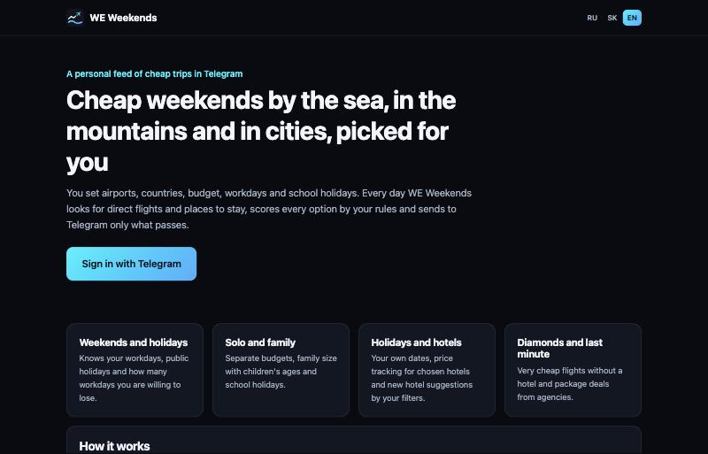
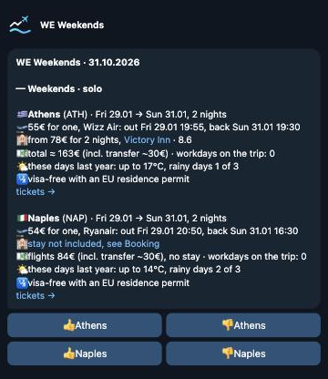
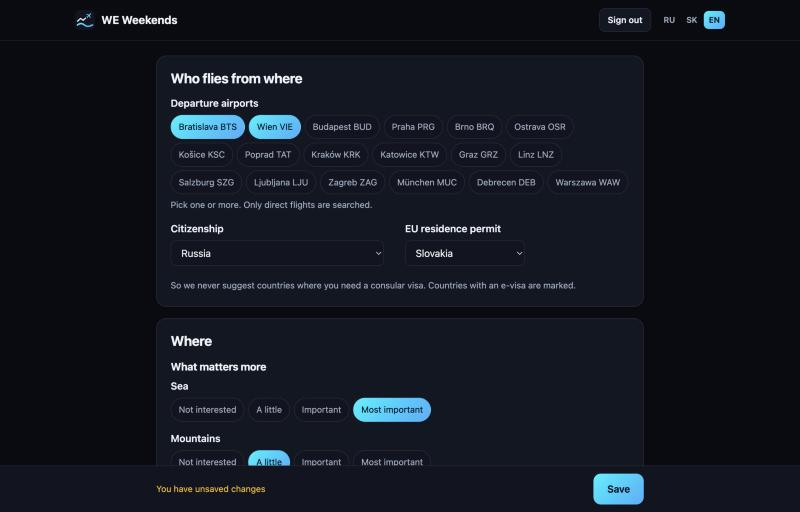
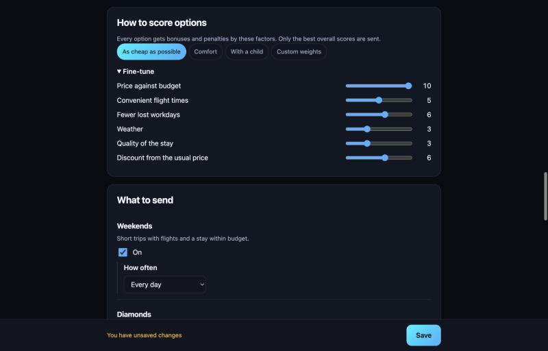
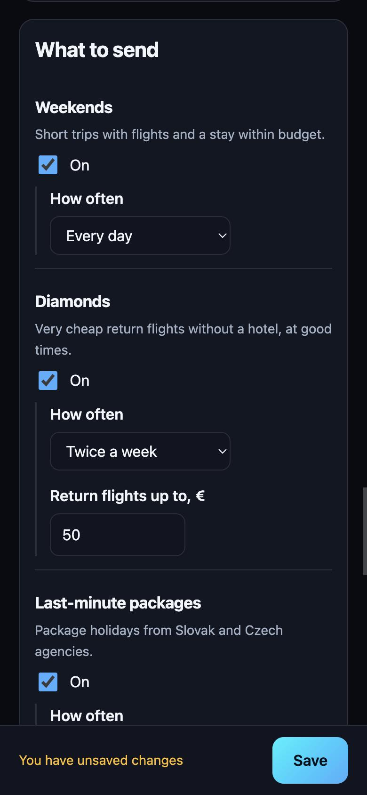

<p align="center">
  
</p>

<h1 align="center">WE Weekends</h1>

<p align="center">
  A free, personal Telegram digest of cheap trips from Central Europe.<br>
  <a href="https://jaffarsk24.github.io/WE-Weekends/"><b>Open the settings page</b></a> · <a href="https://t.me/WEWeekendsBot">@WEWeekendsBot</a> · <a href="https://whiteeagles.sk/en/apps/">Other WE apps</a>
</p>

<p align="center">
  
</p>

You tell WE Weekends where you fly from, where you would like to go, how much you want to spend and when you are free. Every day it looks through direct flights from your airports, checks your workdays, public and school holidays, entry rules for your passport, the weather and the price of a stay, scores every option by your own rules and sends the few best ones to Telegram. You change the settings any time on the website, signing in through the same bot.

**Recommendations only.** WE Weekends sells and books nothing. You book directly with airlines and hotels yourself. We are not a travel agency and take no commissions: partner parameters are stripped from every link. Prices come from public sources and may change before you book.

## What you get

<table>
<tr>
<td width="56%"></td>
<td>

**Weekends.** Short trips with return flights and a stay inside your budget, solo and for the family, with the number of workdays and school days each trip costs you.

**Diamonds.** Very cheap return flights without a hotel, only at hours that do not eat your days off.

**Last-minute packages.** Headlines and prices from Slovak and Czech agencies.

**Holiday.** Your own holiday dates: direct flights to the countries you chose and your tracked hotels with your dates and party already filled in. Each hotel comes with the flight pair that keeps the first and the last day, and when the exact dates have no direct flight, the nearest dates that do, with the hotel's price for them. New hotels can be suggested by your rules: stars, all inclusive, water park, review score and a price limit for the whole stay. Some suggested hotels are not on the seafront, and in Spain many have no beach of their own, so check the hotel page before you book.

Every trip has 👍 and 👎 buttons. They only reorder future suggestions and fade out after two months; nothing is ever hidden for good.

</td>
</tr>
</table>

## Your rules

<p align="center">
  
</p>

- **Departure airports:** Bratislava, Vienna, Budapest, Prague, Brno, Košice, Kraków and others, one or several. Only direct flights.
- **Where:** sea, mountains or sights and how much each matters; whole regions (EU, Schengen, Balkans, Caucasus, Middle East, North Africa and more) plus single countries to add or never suggest.
- **Entry rules:** set your citizenship and EU residence permit, and countries that need a consular visa are left out; e-visas and travel authorisations are marked.
- **Budget:** one for solo trips and one for the family, with the number of adults and the children's ages. Flights for the family are priced for the exact party.
- **Calendar:** public holidays of your country, your workdays, how many workdays you can lose, busy dates, Slovak school holidays by region or your own.
- **Stay:** minimum rating and number of reviews, breakfast, stars.
- **One digest** at the hour you choose, each section at its own frequency, from daily to weekly.

<p align="center">
  
</p>

Every option gets bonuses and penalties for price against budget, flight times, lost workdays, weather, the quality of the stay and the discount from the usual price on that route. Pick a preset (as cheap as possible, comfort, with a child) or fine-tune the weights.

<p align="center">
  
</p>

## How it works

```
GitHub Pages (web/)  ──HTTPS──>  nginx  ──>  gateway (FastAPI, SQLite)  <──  Telegram webhook
                                                   │
                                                   └── engine: shared searches, scoring, digests
```

- **Flights:** Kiwi.com search, direct flights only. Searches run once per departure airport and country and are shared by all users, so the cost does not grow with the number of people.
- **Stays:** Booking.com Demand API when credentials are configured; otherwise public rates from Booking.com, Agoda and Trip.com via Xotelo; then the hotels Stayforlong has around the city; and when no source has a price for the exact dates, the usual price of a good hotel in that city (`server/weekends/data/stay_baseline.json`, built by `server/scripts/build_stay_baseline.py`), marked as an estimate, so every trip has a total. The owner gets a Telegram note on the day a source stops answering.
- **Stayforlong:** the price of the whole holiday stay next to the TripAdvisor ones, with the board and how it is paid (free cancellation, a deposit now, or paid at once), read from the gateway its own site uses, one hotel at a time and cached for half a day. The holiday options "free cancellation only" and "pay later only" pick from these rates. Hotels are matched by name and position (`server/weekends/engine/stayforlong.py`; ids of the suggestion hotels are added by `server/scripts/add_stayforlong_ids.py`).
- **Hotel facts for suggestions:** official stars, all inclusive, water park and kids' facilities of resort hotels in the main beach regions, as Booking.com lists them (`server/weekends/data/hotel_facts.json`, built by `server/scripts/build_hotel_facts.py`). Prices for your dates still come from the stay sources above, daily.
- **Weather:** Open-Meteo forecast for the next two weeks, the same dates last year further out.
- **Data:** public holidays from `holidays`, entry rules from the passport-index dataset with EU residence waivers, destinations from Wikidata.
- **Everything is deterministic code.** No paid services are called per user.

## Privacy and security

We store your Telegram chat id, interface language and saved settings. No names, phone numbers or contacts. Sign-in codes and session keys are kept only as hashes. The site has no analytics, ads or cookies. Delete everything at once on the settings page or with /delete in the bot.

The page runs under a strict Content-Security-Policy with no third-party code; the gateway validates every field against a strict schema, rate-limits per IP, account and chat, and runs in a locked-down container behind nginx and fail2ban. Details and how to report a vulnerability: [SECURITY.md](SECURITY.md).

## Development

```bash
cd server
python3 -m venv .venv && . .venv/bin/activate
pip install --require-hashes -r requirements.txt && pip install -r requirements-dev.txt
pytest -q
```

Run the page with `python3 -m http.server 8791` in `web/`; on localhost it talks to a gateway on port 8790. Print a user's digest without sending it: `python -m weekends.engine.run --dry-run CHAT_ID`.

Deployment notes: `server/deploy/`. License: [MIT](LICENSE). Made by [White Eagles & Co.](https://whiteeagles.sk/en/)
